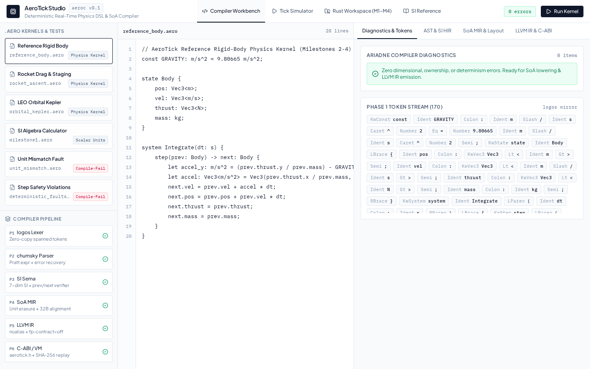
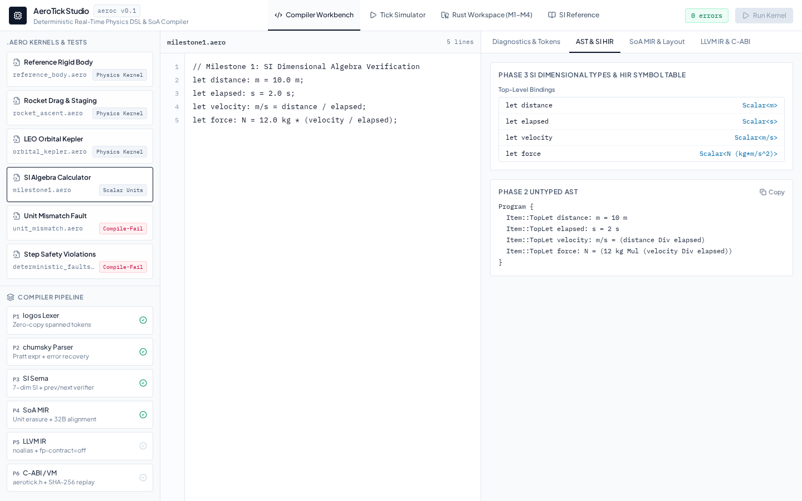
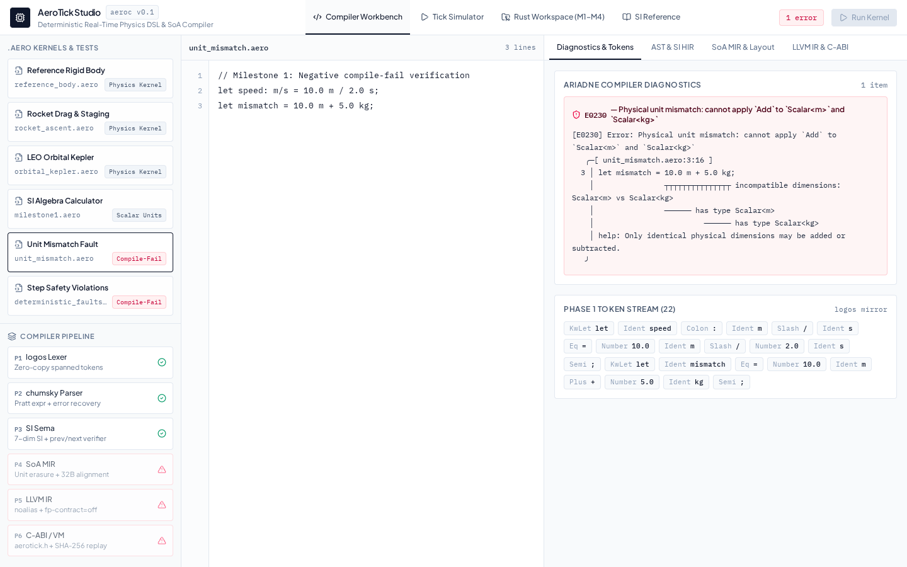
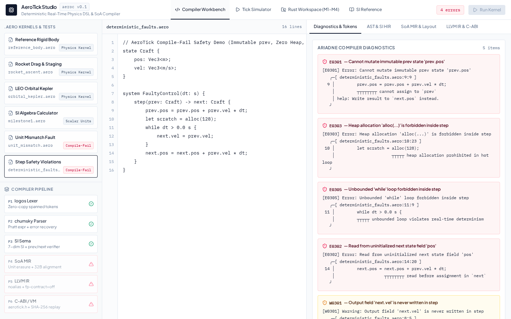
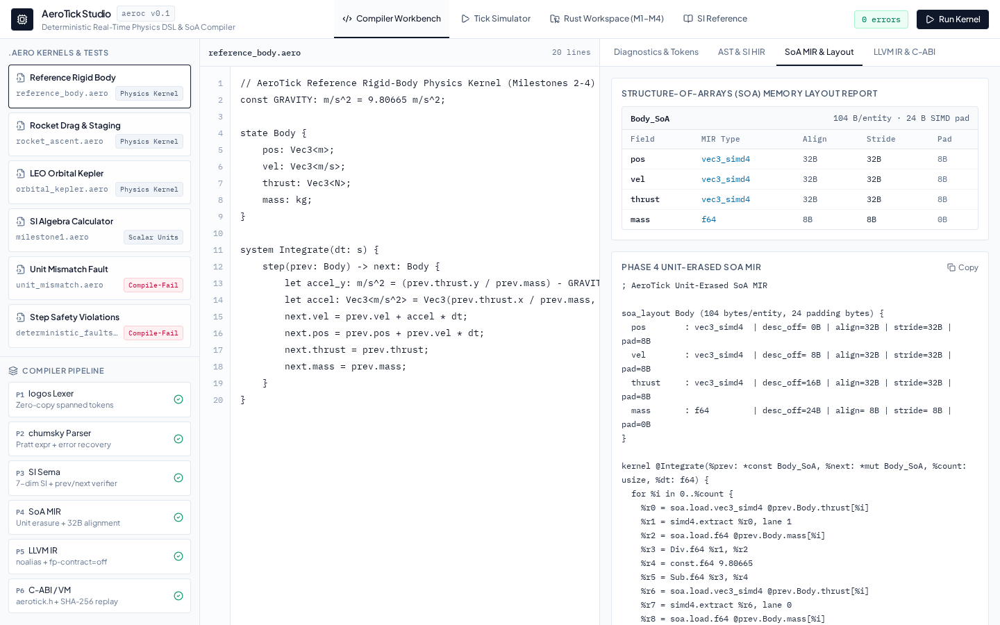
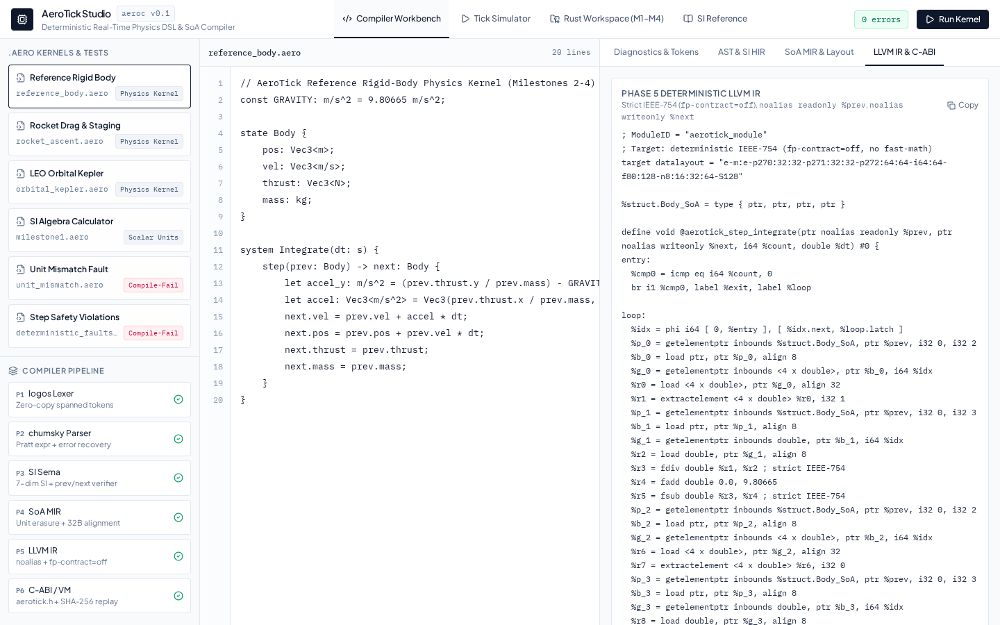
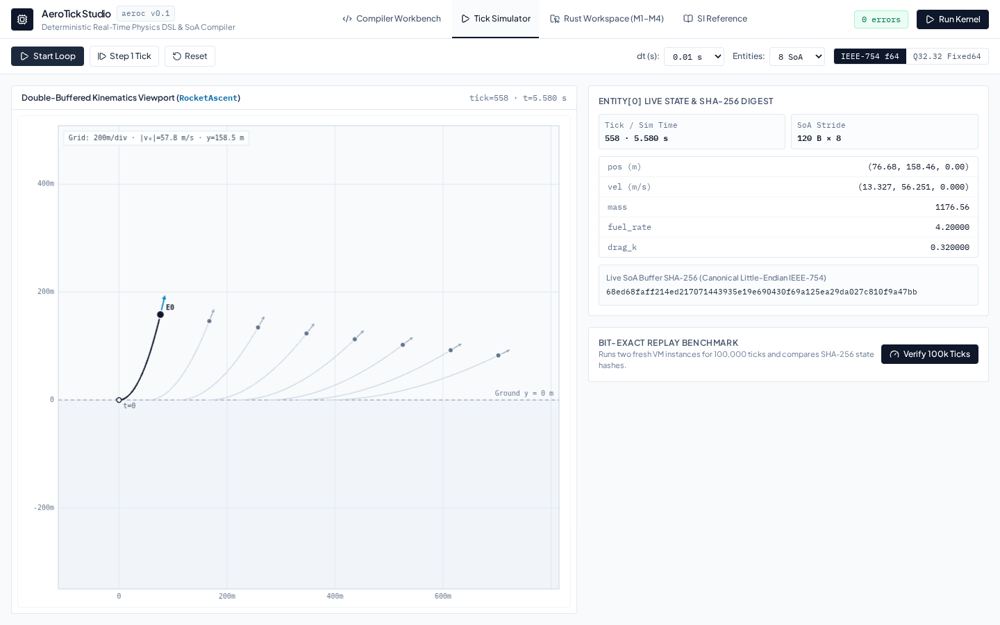
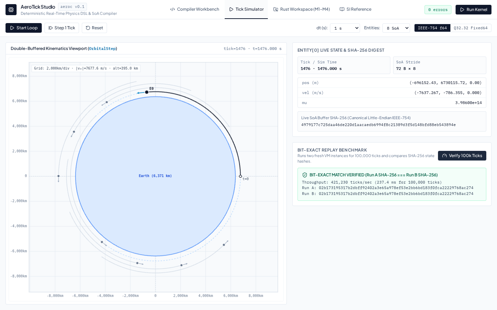
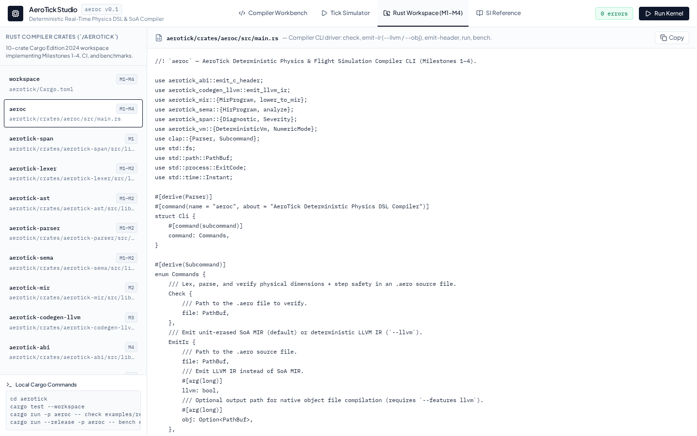
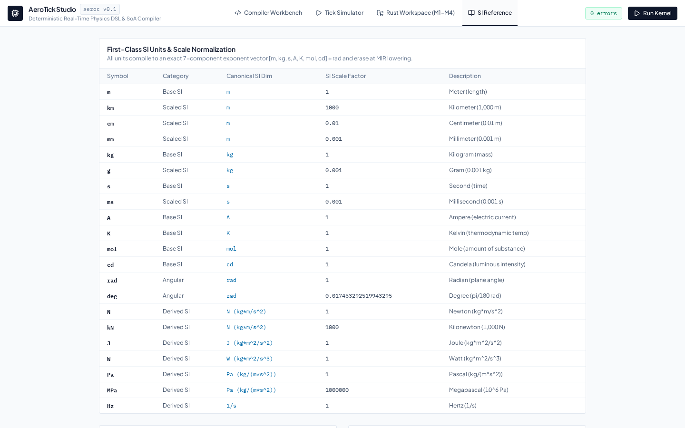

# AeroTick — Deterministic Real-Time Physics DSL & SoA Compiler

**AeroTick** is a deterministic, domain-specific systems programming language and Rust Edition 2024 compiler (`aeroc`) engineered for aerospace kinematics, orbital mechanics, robotics control loops, and real-time 3D physics engines, paired with **AeroTick Studio**, an interactive web-based compiler workbench and deterministic tick simulator.

AeroTick eliminates the three primary sources of catastrophic simulation failures at compile time:
1. **Unit-Mismatch Disasters** — First-class 7-component SI dimensional analysis + angular radians verifies every physical equation at compile time and erases all unit metadata before codegen (**zero runtime cost**).
2. **Data Races & Temporal Coupling** — Tick-driven `step(prev) -> next` double-buffered state architecture enforces immutable `prev` reads and write-only `next` transitions, enabling aliasing-free `noalias` LLVM vectorization.
3. **GC Stutters & Non-Deterministic Drift** — Heap allocations and unbounded loops are forbidden inside `step` blocks; states lower into 32-byte SIMD-aligned Structure-of-Arrays (SoA) buffers executed under strict IEEE-754 (`fp-contract=off`) or `Q32.32` fixed-point arithmetic for bit-exact cross-platform SHA-256 replay.

---

## Compiler Pipeline Architecture (Phases 1–6)

```text
  .aero Source
       │
       ▼
  [Phase 1: aerotick-lexer]        logos zero-copy DFA tokenizer + byte-span tracking
       │
       ▼
  [Phase 2: aerotick-parser]       chumsky Pratt expression parser + panic-mode error recovery
       │
       ▼
  [Phase 3: aerotick-sema]         SI 7-dim + rad inference, Vec3<Unit>, prev/next & zero-heap safety
       │
       ▼
  [Phase 4: aerotick-mir]          Unit erasure + 32-byte aligned SoA memory layout lowering
       │
       ├──────────────────────────────────────┐
       ▼                                      ▼
  [Phase 5: aerotick-codegen-llvm]       [Phase 6: aerotick-vm / aerotick-abi]
  Strict IEEE-754 LLVM IR                Deterministic VM (f64 / Q32.32) + C99 FFI header (aerotick.h)
  (fp-contract=off, noalias)             + Bit-Exact Canonical Little-Endian SHA-256 Replay
```

---

## Table of Contents — 10 Core Features in Detail

1. [Live `.aero` Compiler Workbench & 6-Phase Pipeline Monitor](#1-live-aero-compiler-workbench--6-phase-pipeline-monitor)
2. [First-Class SI Dimensional Analysis & Zero-Cost Unit Inference](#2-first-class-si-dimensional-analysis--zero-cost-unit-inference)
3. [Compile-Time Unit Mismatch Rejection & Multi-Span Ariadne Diagnostics](#3-compile-time-unit-mismatch-rejection--multi-span-ariadne-diagnostics)
4. [Double-Buffered `prev`/`next` Immutability, Zero-Heap & Bounded-Loop Safety Verifier](#4-double-buffered-prevnext-immutability-zero-heap--bounded-loop-safety-verifier)
5. [Unit-Erased Structure-of-Arrays (SoA) MIR & 32-Byte SIMD Memory Layout](#5-unit-erased-structure-of-arrays-soa-mir--32-byte-simd-memory-layout)
6. [Strict IEEE-754 LLVM IR (`fp-contract=off`, `noalias`) & Exported C99/C++ Header (`aerotick.h`)](#6-strict-ieee-754-llvm-ir-fp-contractoff-noalias--exported-c99c-header-aerotickh)
7. [Real-Time Rocket Ascent Simulation with Variable Mass & Quadratic Drag](#7-real-time-rocket-ascent-simulation-with-variable-mass--quadratic-drag)
8. [Symplectic LEO Orbital Kepler Integrator & 100k-Tick Bit-Exact SHA-256 Replay](#8-symplectic-leo-orbital-kepler-integrator--100k-tick-bit-exact-sha-256-replay)
9. [10-Crate Rust Edition 2024 Compiler Workspace & `aeroc` CLI](#9-10-crate-rust-edition-2024-compiler-workspace--aeroc-cli)
10. [Built-In 21 SI Units, Type-Safe `Vec3` Intrinsics & Error Code Catalog](#10-built-in-21-si-units-type-safe-vec3-intrinsics--error-code-catalog)

---

## Detailed Feature Breakdown

### 1. Live `.aero` Compiler Workbench & 6-Phase Pipeline Monitor



**AeroTick Studio** provides an interactive split-pane compiler workbench that compiles `.aero` source files on every keystroke through all 6 compiler phases (`P1` through `P6`):

- **Preset Kernel Switcher & Live Editor**: Switch instantly between physics kernels (`reference_body.aero`, `rocket_ascent.aero`, `orbital_kepler.aero`), scalar unit algebra (`milestone1.aero`), and negative compile-fail demonstrations (`unit_mismatch.aero`, `deterministic_faults.aero`), or edit any line directly with synchronized line numbers and one-click preset reset.
- **Live 6-Stage Pipeline Tracker**: The left sidebar continuously indicates pass/block status for `P1 logos Lexer`, `P2 chumsky Parser`, `P3 SI Sema`, `P4 SoA MIR`, `P5 LLVM IR`, and `P6 C-ABI / VM`.
- **Phase 1 Token Stream Inspector**: View the exact zero-copy token sequence (`KwConst`, `Ident`, `KwVec3`, `KwSystem`, `KwStep`, operators, literals) produced by the lexer before parsing begins.
- **Instant Kernel Launch**: Whenever a file compiles with zero errors and defines at least one `system`/`step` kernel, the **Run Kernel** button activates to launch the compiled SoA MIR directly into the deterministic tick simulator.

---

### 2. First-Class SI Dimensional Analysis & Zero-Cost Unit Inference



Physical dimensions in AeroTick are not comments or wrapper structs—they are native types checked by the semantic analyzer (`aerotick-sema`) using an exact 7-component integer exponent vector `[m, kg, s, A, K, mol, cd]` plus angular `rad`:

```aero
let distance: m = 10.0 m;
let elapsed: s = 2.0 s;
let velocity: m/s = distance / elapsed;
let force: N = 12.0 kg * (velocity / elapsed);
```

- **Automatic Dimensional Algebra**: Dividing `m` by `s` automatically deduces `Scalar<m/s>`. Multiplying `kg` by `(m/s) / s` deduces `Scalar<kg*m/s^2>` and canonicalizes it against `N` (`Newton`).
- **Scale Normalization**: Scaled inputs like `km`, `cm`, `mm`, `g`, `ms`, `deg`, `kN`, and `MPa` are normalized to canonical SI base units (`1000.0`, `0.01`, `0.001`, `pi/180`, etc.) at compile time so mixed-scale equations such as `1.0 km + 500.0 m` evaluate cleanly to `1500.0 m`.
- **Phase 2 AST & Phase 3 HIR Inspection**: The **AST & SI HIR** tab displays both the untyped Pratt-parsed AST (`Item::TopLet`, binary expressions) and the fully resolved SI symbol table (`Scalar<m>`, `Scalar<s>`, `Scalar<m/s>`, `Scalar<N (kg*m/s^2)>`).
- **Zero-Cost Abstraction**: Once type-checked in Phase 3, every unit tag is stripped in Phase 4 MIR lowering so runtime execution runs on raw `f64` / SIMD lanes with zero unit overhead.

---

### 3. Compile-Time Unit Mismatch Rejection & Multi-Span Ariadne Diagnostics



Incompatible physical operations are caught immediately at compile time with rich **Ariadne-style multi-span diagnostics** that pinpoint both the offending operator and each operand's inferred physical dimension:

```aero
let speed: m/s = 10.0 m / 2.0 s;
let mismatch = 10.0 m + 5.0 kg;
```

- **`E0230` Physical Unit Mismatch**: Rejects `10.0 m + 5.0 kg` while annotating `10.0 m` (`Scalar<m>`) and `5.0 kg` (`Scalar<kg>`) on separate underlined spans with an actionable diagnostic note.
- **Additional Dimensional Guards**:
  - **`E0237`**: Compile-time zero scalar divisor inside expressions (`10.0 m / 0.0 s`).
  - **`E0221`**: Odd-exponent square root rejection (e.g., `sqrt(10.0 m)` fails because `m` cannot be halved to an integer exponent, while `sqrt(100.0 m^2/s^2)` succeeds as `m/s`).
  - **`E0222`**: Trigonometric functions (`sin`, `cos`, `tan`) require `rad` or dimensionless `1`, rejecting non-angular dimensions like meters or seconds.
- **Panic-Mode Parser Recovery (`E0102`)**: Even when a statement contains a syntax error, the parser synchronizes on semicolons and closing braces to continue verifying all remaining items in the file.

---

### 4. Double-Buffered `prev`/`next` Immutability, Zero-Heap & Bounded-Loop Safety Verifier



Inside every `system ... { step(prev: State) -> next: State { ... } }` block, `aerotick-sema` enforces strict real-time flight-software invariants:

```aero
system FaultyControl(dt: s) {
    step(prev: Craft) -> next: Craft {
        prev.pos = prev.pos + prev.vel * dt; // E0301: Immutable prev mutation
        let scratch = alloc(128);            // E0303: Forbidden heap allocation
        while dt > 0.0 s {                   // E0305: Unbounded loop forbidden
            next.vel = prev.vel;
        }
        next.pos = next.pos + prev.vel * dt; // E0302: Read from uninitialized next
    }
}
```

- **`E0301` — Immutable `prev` State**: Any write target rooted in `prev.*` is rejected so every entity reads a frozen snapshot of frame `t` without order-dependent side effects.
- **`E0302` — Uninitialized `next` Read**: Reading `next.pos` before it has been initialized on all preceding paths inside `step` is forbidden.
- **`E0303` — Zero Heap Allocation in the Hot Loop**: Calls to `alloc`, `malloc`, `calloc`, `realloc`, `Vec`, `Box`, or `spawn` are rejected inside `step`, guaranteeing zero GC pauses or allocator latency spikes.
- **`E0305` — Bounded Control Flow**: `while` and unbounded `loop` constructs are prohibited inside real-time tick kernels to preserve deterministic WCET (worst-case execution time).
- **`W0301` — Unwritten `next` Field Warning**: Flags any state field omitted from `next.*` assignments (`next.vel` inside the invalid loop) so state carry-over is never accidentally dropped.

---

### 5. Unit-Erased Structure-of-Arrays (SoA) MIR & 32-Byte SIMD Memory Layout



Phase 4 (`aerotick-mir`) strips all SI unit metadata and transforms Array-of-Structures (AoS) declarations into cache-friendly, **32-byte aligned Structure-of-Arrays (SoA)** buffers optimized for AVX2 / NEON vectorization:

| Field | MIR Type | Active Lanes | Padded Lanes | Align | Stride / Entity | SIMD Pad |
| :--- | :--- | :---: | :---: | :---: | :---: | :---: |
| `pos` | `vec3_simd4` | 3 (`x,y,z`) | 4 (`<4 x double>`) | `32B` | `32B` | `8B` |
| `vel` | `vec3_simd4` | 3 (`x,y,z`) | 4 (`<4 x double>`) | `32B` | `32B` | `8B` |
| `thrust` | `vec3_simd4` | 3 (`x,y,z`) | 4 (`<4 x double>`) | `32B` | `32B` | `8B` |
| `mass` | `f64` | 1 | 1 (`double`) | `8B` | `8B` | `0B` |
| **Total `Body_SoA`** | — | **10** | **13** | — | **`104 B/entity`** | **`24 B`** |

- **Contiguous Hot-Loop Arrays**: Each field (`pos[]`, `vel[]`, `thrust[]`, `mass[]`) lives in its own contiguous buffer indexed by entity lane `%i`, eliminating cache-line pollution when a kernel reads only a subset of fields.
- **Explicit SIMD Lane Extraction & Packing**: `Vec3` fields map to `<4 x double>` (`vec3_simd4`) with deterministic `simd4.extract` and `simd4.pack` MIR instructions (`soa.load.vec3_simd4 @prev.Body.thrust[%i]`, `soa.store.vec3_simd4 @next.Body.pos[%i]`).

---

### 6. Strict IEEE-754 LLVM IR (`fp-contract=off`, `noalias`) & Exported C99/C++ Header (`aerotick.h`)



Phases 5 and 6 lower the verified SoA MIR into native LLVM IR (`aerotick-codegen-llvm`) and an embeddable C99/C++ FFI header (`aerotick-abi`):

- **Cross-Platform Float Determinism**: Emits `"fp-contract"="off"` and `"no-infs-fp-math"="false"` (zero `fast-math`, zero fused multiply-add contraction) so ARM64 and x86_64 produce identical IEEE-754 rounding behavior down to the last bit.
- **Aliasing-Free Parallel Vectorization**: Kernel signatures annotate `%prev` as `ptr noalias readonly` and `%next` as `ptr noalias writeonly`, unlocking safe auto-vectorization and multi-core parallel dispatch across entity ranges.
- **Ready-to-Embed C99/C++ Header (`aerotick.h`)**: Exports `AeroVec3Simd4`, the typed SoA descriptor struct (`Body_SoA`), and `void aerotick_step_integrate(const Body_SoA *prev, Body_SoA *next, size_t count, double dt)` for zero-overhead integration into Unreal Engine, Godot 4 GDExtension, or embedded flight computers.

---

### 7. Real-Time Rocket Ascent Simulation with Variable Mass & Quadratic Drag



The **Tick Simulator** executes compiled SoA MIR kernels in real time inside a double-buffered `DeterministicRuntime` VM and renders all entities on a world-space 1:1 kinematics viewport:

```aero
system RocketAscent(dt: s) {
    step(prev: Rocket) -> next: Rocket {
        let speed: m/s = norm(prev.vel);
        let drag_force: Vec3<N> = prev.vel * (-prev.drag_k * speed);
        let gravity_force: Vec3<N> = Vec3(0.0, -prev.mass * GRAVITY, 0.0);
        let net_force: Vec3<N> = prev.thrust + drag_force + gravity_force;
        let accel: Vec3<m/s^2> = net_force / prev.mass;
        let next_vel: Vec3<m/s> = prev.vel + accel * dt;
        next.vel = next_vel;
        next.pos = prev.pos + next_vel * dt;
        next.mass = max(250.0 kg, prev.mass - prev.fuel_rate * dt);
        next.thrust = prev.thrust;
        next.fuel_rate = prev.fuel_rate;
        next.drag_k = prev.drag_k;
    }
}
```

- **Full-History Trajectory & Multi-Entity SoA Swarm**: Tracks `Entity[0]` (`E0`) and secondary SoA lanes (`1..7`) from `t=0` launch origin with stride-compacted trails, directional velocity arrowheads, ground datum (`y = 0 m`), and adaptive world-space meter/kilometer grid ticks.
- **Live Telemetry & Dual Numeric Modes**: Inspect live `pos`, `vel`, `mass`, `fuel_rate`, `drag_k`, SoA stride (`120 B × 8`), configurable `dt` (`0.001 s`–`1.0 s`), and switch between **IEEE-754 `f64`** and **`Q32.32` fixed-point** arithmetic.

---

### 8. Symplectic LEO Orbital Kepler Integrator & 100k-Tick Bit-Exact SHA-256 Replay



Running `orbital_kepler.aero` demonstrates long-horizon energy-conserving symplectic integration in Low Earth Orbit (`400 km` altitude above Earth radius `6,371 km`, `mu = 3.986004418e14 m^3/s^2`) paired with cryptographic determinism verification:

- **Earth + LEO Reference Framing**: Renders the planetary sphere (`6,371 km`), dashed `400 km LEO` circular reference ring, orbital trajectory arc from `t=0`, and real-time orbital speed & altitude telemetry (`|v₀| = 7677.6 m/s`, `alt = 395.0 km`).
- **One-Click 100,000-Tick Bit-Exact Replay Benchmark**: Clicking **Verify 100k Ticks** spawns two independent fresh VM instances (`Run A` and `Run B`), advances each for `100,000` ticks, serializes every SoA lane in canonical little-endian IEEE-754 byte order (normalizing `-0.0` to `+0.0`), and asserts `Run A SHA-256 === Run B SHA-256` alongside measured throughput (`ticks/sec`).

---

### 9. 10-Crate Rust Edition 2024 Compiler Workspace & `aeroc` CLI



Inside `/aerotick`, the full native Rust compiler is organized as a modular 10-crate Cargo workspace (`resolver = "3"`, `edition = "2024"`), browsable directly from the **Rust Workspace (M1–M4)** tab in AeroTick Studio:

| Crate | Milestone | Responsibility |
| :--- | :---: | :--- |
| `aerotick-span` | M1 | Source file table, byte-offset `Span`s, and `ariadne` multi-span diagnostic renderer |
| `aerotick-lexer` | M1–M2 | `logos` zero-copy tokenizer for SI identifiers, literals, vectors, and system keywords |
| `aerotick-ast` | M1–M2 | Typed AST definitions for units, expressions, `const`, `state`, and `system`/`step` |
| `aerotick-parser` | M1–M2 | `chumsky` Pratt expression parser with error recovery and synchronization |
| `aerotick-sema` | M1–M2 | 7-dim SI algebra + `rad`, `Vec3<Unit>`, `prev`/`next`, zero-heap, and bounded-loop checks |
| `aerotick-mir` | M2 | Unit erasure and 32-byte aligned SoA layout & MIR lowering |
| `aerotick-codegen-llvm` | M3 | Deterministic LLVM IR emitter (`fp-contract=off`, `noalias`) + optional `inkwell` native object codegen (`--features llvm`) |
| `aerotick-abi` | M4 | C99/C++ FFI header (`aerotick.h`) generator with `AeroVec3Simd4` and `_Static_assert` checks |
| `aerotick-vm` | M4 | Deterministic SoA VM (`Float64` / `Fixed64` Q32.32) + canonical little-endian SHA-256 replay |
| `aeroc` | M1–M4 | Production CLI (`check`, `emit-ir`, `emit-header`, `run`, `bench`) |

---

### 10. Built-In 21 SI Units, Type-Safe `Vec3` Intrinsics & Error Code Catalog



The **SI Reference** view documents the complete built-in physical type system, vector intrinsics, and compiler diagnostic catalog:

- **21 Built-In SI & Scaled Units**: All 7 SI base units (`m`, `kg`, `s`, `A`, `K`, `mol`, `cd`), angular (`rad`, `deg`), scaled prefixes (`km`, `cm`, `mm`, `g`, `ms`), and derived mechanical/energy units (`N`, `kN`, `J`, `W`, `Pa`, `MPa`, `Hz`), plus arbitrary compound exponents (`m/s^2`, `m^3/s^2`, `kg*m^2/s^2`).
- **Dimension-Propagating Intrinsics**:
  - `dot(Vec3<A>, Vec3<B>) -> Scalar<A*B>` & `cross(Vec3<A>, Vec3<B>) -> Vec3<A*B>`
  - `norm(Vec3<A>) -> Scalar<A>` & `normalize(Vec3<A>) -> Vec3<1>`
  - `sqrt(Scalar<A^2>) -> Scalar<A>` (halves all 7 SI exponents; rejects odd exponents with `E0221`)
  - `sin / cos / tan(Scalar<rad | 1>) -> Scalar<1>`
  - `min / max(T, T) -> T` & branchless `select(Bool, T, T) -> T`

---

## Running Locally

### 1. AeroTick Studio (Web Workbench & Simulator)

```bash
npm install
npm run dev          # Starts Vite playground on http://localhost:3000
npm run build        # Production bundle
npm run lint         # TypeScript typecheck (tsc --noEmit)
npx tsx --test src/compiler/compiler.test.ts
```

### 2. AeroTick Native Rust Compiler (`aeroc`) & 1M-Tick Benchmark

> Requires Rust (Edition 2024 toolchain). Pass `--features llvm` if LLVM 18 dev headers are installed for native `.o` object emission via `inkwell`.

```bash
cd aerotick

# Run all workspace unit, negative compile-fail, MIR, LLVM-IR, and SHA-256 replay tests
cargo test --workspace

# Check a physics kernel and inspect Ariadne diagnostics
cargo run -p aeroc -- check examples/reference_body.aero
cargo run -p aeroc -- check examples/unit_mismatch.aero

# Emit SoA MIR, deterministic LLVM IR, and C99 FFI header
cargo run -p aeroc -- emit-ir examples/reference_body.aero
cargo run -p aeroc -- emit-ir --llvm examples/reference_body.aero
cargo run -p aeroc -- emit-header examples/reference_body.aero

# Run 100k+ or 1,000,000-tick deterministic simulation & SHA-256 replay verification
cargo run --release -p aeroc -- run examples/rocket_ascent.aero --ticks 10000 --entities 64
cargo run --release -p aeroc -- bench examples/reference_body.aero --ticks 1000000
```

### 3. CI Pipeline

GitHub Actions (`.github/workflows/ci.yml`) automatically verifies formatting (`cargo fmt --all -- --check`), strict lints (`cargo clippy --workspace --all-targets -- -D warnings`), full workspace tests (`cargo test --workspace`), and `aeroc` CLI integration smoke checks on every push and pull request.
